# Example 01 — Pod: the smallest thing Kubernetes runs

**Shows:** one pod on its own: where it runs, its IP, its logs, a shell
inside it, a container restart, and what happens when you delete it.

**Objects:** Namespace, Pod · **Namespace:** `ex-pod` · **About 5 minutes**

`$` = workstation · [All examples](../README.md)



## Apply

```bash
$ cd "$K8S_COURSE_HOME"
$ cat examples/01-pod/pod.yaml
$ kubectl apply -f examples/01-pod/pod.yaml
$ kubectl -n ex-pod wait --for=condition=Ready pod/podinfo --timeout=120s
```

## Look at it

```bash
$ kubectl -n ex-pod get pod podinfo -o wide
$ kubectl -n ex-pod describe pod podinfo
$ kubectl -n ex-pod logs podinfo --tail=5
$ kubectl -n ex-pod exec podinfo -- curl -s localhost:9898/version
```

- `-o wide` adds the pod's **IP** and its **node**. The scheduler picked the
  node; the IP comes from the network plugin (Cilium).
- At the bottom of `describe`, the **Events** tell the pod's story:
  `Scheduled` → `Pulling` → `Pulled` → `Created` → `Started`.
- `exec` runs a command inside the container. podinfo answers on port 9898.

See podinfo's web page in your browser. `port-forward` runs until you stop it
with `Ctrl-C`, so use a second terminal:

<!-- smoke: skip (port-forward runs until Ctrl-C) -->
```bash
$ kubectl -n ex-pod port-forward pod/podinfo 9898:9898
```

Open `http://localhost:9898`. The page shows the pod's name as its hostname.

## Try this

**Crash the container.** podinfo exits when you call `/panic`. The kubelet
restarts the container, in the same pod, on the same node:

```bash
$ kubectl -n ex-pod exec podinfo -- curl -s localhost:9898/panic || echo "the connection dropped: podinfo exited"
$ sleep 10
$ kubectl -n ex-pod get pod podinfo
$ kubectl -n ex-pod logs podinfo --previous --tail=3
```

`RESTARTS` is now 1. `logs --previous` shows the log of the container that
died: the place to look when a pod keeps restarting.

**Delete the pod.** Note its IP first:

```bash
$ kubectl -n ex-pod get pod podinfo -o jsonpath='{.status.podIP}{"\n"}'
$ kubectl -n ex-pod delete pod podinfo
$ kubectl -n ex-pod get pods
```

Nothing brings it back: a bare pod has no controller. Apply the file again
and compare the IP:

```bash
$ kubectl apply -f examples/01-pod/pod.yaml
$ kubectl -n ex-pod wait --for=condition=Ready pod/podinfo --timeout=120s
$ kubectl -n ex-pod get pod podinfo -o jsonpath='{.status.podIP}{"\n"}'
```

## What to remember

- A pod is one or more containers that share an IP. It runs on one node and
  stays there until it is deleted.
- A crashed container is restarted **inside** the pod (`RESTARTS` goes up). A
  deleted pod is gone; a new pod is a new object with a new IP.
- That is why you almost never create pods yourself: a controller (example 05
  and on) creates and replaces them, and a Service (example 11) gives them an
  address that does not change.

## Clean up

```bash
$ kubectl delete namespace ex-pod
```
