# Example 02 — Init containers and sidecars: several containers, one pod

**Shows:** an init container that runs first and exits, and a sidecar that
runs next to the app. All three share the pod's volume and its `localhost`.

**Objects:** Pod with an init container, two containers and an `emptyDir`
volume · **Namespace:** `ex-multi` · **About 5 minutes**

`$` = workstation · [All examples](../README.md)



## Apply

```bash
$ cd "$K8S_COURSE_HOME"
$ cat examples/02-multi-container/pod.yaml
$ kubectl apply -f examples/02-multi-container/pod.yaml
$ kubectl -n ex-multi wait --for=condition=Ready pod/podinfo --timeout=120s
```

## Look at it

```bash
$ kubectl -n ex-multi get pod podinfo
$ kubectl -n ex-multi get pod podinfo -o jsonpath='{range .status.initContainerStatuses[*]}{.name}: {.state.terminated.reason}{"\n"}{end}'
$ kubectl -n ex-multi logs podinfo -c probe --tail=3
$ kubectl -n ex-multi exec podinfo -c podinfo -- curl -s localhost:9898/configs
```

- `READY 2/2`: two containers run. The init container is not counted; it
  finished (`Completed`) before they started.
- With more than one container, `logs` and `exec` need `-c <container>`.
  Without it, kubectl picks the default container and says so.
- The sidecar reached podinfo at `localhost:9898`: the containers of a pod
  share one network namespace, so one IP and one set of ports.
- `/configs` lists the files in podinfo's `/configs`: `init.txt` from the init
  container and `sidecar.txt`, which the sidecar rewrites every 5 seconds. One
  `emptyDir` volume, mounted in all three containers.

`describe` shows the containers in the order they run:

```bash
$ kubectl -n ex-multi describe pod podinfo
```

## Try this

**An init container that fails.** This pod waits for a database that does
not exist:

```bash
$ kubectl apply -f examples/02-multi-container/broken-init.yaml
$ sleep 20
$ kubectl -n ex-multi get pod broken
$ kubectl -n ex-multi logs broken -c wait-for-database
```

The status is `Init:Error` or `Init:CrashLoopBackOff`, and the podinfo
container never starts. When a pod hangs in `Init:`, read the init
container's log: it usually waits for something that is not there.

## What to remember

- Containers in one pod are scheduled together, share an IP and can share
  volumes. Put two processes in one pod only when they must live and die
  together (an app and its log shipper, proxy or secret agent).
- Init containers run in order, each to completion, before any container
  starts. Use them for preparation: wait for a dependency, fetch a file,
  fix permissions.
- Since Kubernetes 1.29 a sidecar can also be declared as an init container
  with `restartPolicy: Always`: it starts before the app and stops after it.
- The platform uses this pattern: the Vault Agent Injector adds an init
  container (fetch the secrets once) and a sidecar (keep them fresh) to the
  pods that ask for secrets.

## Clean up

```bash
$ kubectl delete namespace ex-multi
```
