# Example 03 — Probes: ready for traffic, and still alive

**Shows:** a failing **readiness** probe takes a pod out of its Service
without restarting it; a failing **liveness** probe makes the kubelet restart
the container.

**Objects:** Deployment with two probes, Service · **Namespace:** `ex-probes` · **About 10 minutes**

`$` = workstation · [All examples](../README.md)



## Apply

```bash
$ cd "$K8S_COURSE_HOME"
$ cat examples/03-probes/deployment.yaml
$ kubectl apply -f examples/03-probes/deployment.yaml
$ kubectl -n ex-probes rollout status deployment/podinfo --timeout=120s
```

## Look at it

Both pods are ready, so both are endpoints of the Service:

```bash
$ kubectl -n ex-probes get pods
$ kubectl -n ex-probes get endpointslices -l kubernetes.io/service-name=podinfo -o jsonpath='{range .items[*].endpoints[*]}{.targetRef.name}  ready={.conditions.ready}{"\n"}{end}'
```

## Try this

**Fail the readiness probe.** podinfo stops reporting ready when you ask it
to. Pick the first pod:

```bash
$ POD=$(kubectl -n ex-probes get pods -l app=podinfo -o name | sed -n 1p)
$ kubectl -n ex-probes exec "$POD" -- curl -s -X POST localhost:9898/readyz/disable
$ sleep 10
$ kubectl -n ex-probes get pods
$ kubectl -n ex-probes get endpointslices -l kubernetes.io/service-name=podinfo -o jsonpath='{range .items[*].endpoints[*]}{.targetRef.name}  ready={.conditions.ready}{"\n"}{end}'
$ kubectl -n ex-probes describe "$POD" | tail -5
```

- The pod shows `READY 0/1` but `STATUS Running` and `RESTARTS 0`: nothing is
  restarted.
- In the EndpointSlice it is `ready=false`: the Service sends it no traffic.
- The events say `Readiness probe failed: HTTP probe failed with statuscode: 503`.

Make it ready again:

```bash
$ kubectl -n ex-probes exec "$POD" -- curl -s -X POST localhost:9898/readyz/enable
$ sleep 10
$ kubectl -n ex-probes get pods
```

**Fail the liveness probe.** With `PODINFO_UNHEALTHY=true`, podinfo's
`/healthz` never succeeds. Changing an environment variable rolls out new
pods:

```bash
$ kubectl -n ex-probes set env deployment/podinfo PODINFO_UNHEALTHY=true
$ kubectl -n ex-probes rollout status deployment/podinfo --timeout=120s
$ sleep 45
$ kubectl -n ex-probes get pods
$ kubectl -n ex-probes describe "$(kubectl -n ex-probes get pods -l app=podinfo -o name | sed -n 1p)" | tail -6
```

`RESTARTS` goes up every 15 seconds or so (3 failures × 5 s), and after a few
rounds the status turns to `CrashLoopBackOff`: the kubelet waits longer and
longer between restarts. The events say `Liveness probe failed` and
`Container podinfo failed liveness probe, will be restarted`.

Remove the variable to fix it:

```bash
$ kubectl -n ex-probes set env deployment/podinfo PODINFO_UNHEALTHY-
$ kubectl -n ex-probes rollout status deployment/podinfo --timeout=120s
$ kubectl -n ex-probes get pods
```

## What to remember

| Probe | Question | When it fails |
|---|---|---|
| `readinessProbe` | May this pod receive traffic now? | Removed from the Service's endpoints; not restarted |
| `livenessProbe` | Is this container still working? | The kubelet restarts the container |
| `startupProbe` | Has the app finished starting? | The other two wait until it succeeds; for slow starters |

- A pod that is `Running` but `0/1` is failing its readiness probe: `describe`
  says why.
- A liveness probe that is too strict (too short a timeout, checks a database
  the app depends on) turns a slow moment into a restart loop. Liveness should
  check only the process itself.

## Clean up

```bash
$ kubectl delete namespace ex-probes
```
