# Example 04 — Requests, limits and QoS classes

**Shows:** how requests and limits put a pod in a QoS class, what happens when
a container goes over its memory limit (`OOMKilled`), and what happens when
no node has room for a pod's requests (`Pending`).

**Objects:** Pods with and without `resources` · **Namespace:** `ex-resources` · **About 10 minutes**

`$` = workstation · [All examples](../README.md)



## Apply

```bash
$ cd "$K8S_COURSE_HOME"
$ cat examples/04-resources/qos.yaml
$ kubectl apply -f examples/04-resources/qos.yaml
$ kubectl -n ex-resources wait --for=condition=Ready pod --all --timeout=120s
```

## Look at it

```bash
$ kubectl -n ex-resources get pods -o custom-columns='NAME:.metadata.name,QOS:.status.qosClass,REQUESTS:.spec.containers[0].resources.requests,LIMITS:.spec.containers[0].resources.limits'
```

| QoS class | Rule | When the node runs out of memory |
|---|---|---|
| `Guaranteed` | requests = limits, for CPU and memory, in every container | Evicted last |
| `Burstable` | at least one request or limit, but not Guaranteed | In between |
| `BestEffort` | no requests and no limits at all | Evicted first |

Kubernetes set the class; you choose it only through `resources`.

## Try this

**Go over the memory limit.** This pod loads 100 MB into memory but has a
64 MiB limit:

```bash
$ kubectl apply -f examples/04-resources/oom.yaml
$ sleep 30
$ kubectl -n ex-resources get pod oom
$ kubectl -n ex-resources get pod oom -o jsonpath='{.status.containerStatuses[0].lastState.terminated.reason}{"\n"}'
```

The last state is `OOMKilled`: the kernel killed the process the moment it
went over the limit. The kubelet restarts it, it is killed again: soon the
status is `CrashLoopBackOff`. Memory is not compressible: over the limit
means killed. CPU over the limit only means slowed down (throttled).

**Ask for more than any node has.** This pod requests 64 CPUs:

```bash
$ kubectl apply -f examples/04-resources/too-big.yaml
$ sleep 5
$ kubectl -n ex-resources get pod too-big
$ kubectl -n ex-resources describe pod too-big | tail -3
```

It stays `Pending`, and the event says why: `Insufficient cpu`. The scheduler
places pods by their **requests**, compared with what is still unrequested on
each node. It does not look at how busy the node really is. See what is
requested on your nodes:

```bash
$ kubectl describe nodes | grep -A 7 'Allocated resources'
$ kubectl -n ex-resources top pods || echo "no metrics yet: try again in a minute"
```

`top` shows what the pods really use. Compare it with their requests.

## What to remember

- **Requests** reserve room on a node and decide where a pod can run. Too
  high wastes the cluster; too low packs pods onto nodes that cannot carry them.
- **Limits** are enforced by the kernel. CPU over the limit is throttled;
  memory over the limit is `OOMKilled`.
- `Pending` with `Insufficient cpu` or `Insufficient memory` means the
  requests do not fit. The node may still look idle.

## Clean up

```bash
$ kubectl delete namespace ex-resources
```
