# Example 05 — ReplicaSet: keep N pods running

**Shows:** the reconcile loop at its simplest. A ReplicaSet counts the pods
that match its label selector and creates or deletes pods until the count is
right, whatever happened to them.

**Objects:** ReplicaSet · **Namespace:** `ex-replicaset` · **About 5 minutes**

`$` = workstation · [All examples](../README.md)



## Apply

```bash
$ cd "$K8S_COURSE_HOME"
$ cat examples/05-replicaset/replicaset.yaml
$ kubectl apply -f examples/05-replicaset/replicaset.yaml
$ kubectl -n ex-replicaset wait --for=condition=Ready pod -l app=podinfo --timeout=120s
```

## Look at it

```bash
$ kubectl -n ex-replicaset get replicaset podinfo
$ kubectl -n ex-replicaset get pods --show-labels
$ POD=$(kubectl -n ex-replicaset get pods -l app=podinfo -o name | sed -n 1p)
$ kubectl -n ex-replicaset get "$POD" -o jsonpath='{.metadata.ownerReferences[0].kind}/{.metadata.ownerReferences[0].name}{"\n"}'
```

Each pod name is the ReplicaSet's name plus a random suffix, and each pod
records its owner in `ownerReferences`.

## Try this

**Delete a pod.** The ReplicaSet notices the count is 2 and makes a third:

```bash
$ kubectl -n ex-replicaset delete "$POD"
$ kubectl -n ex-replicaset get pods
```

On a projector, run `kubectl -n ex-replicaset get pods -w` in a second
terminal first, or watch the namespace in k9s.

**Take a pod out by changing its label.** The selector is the only thing
that decides ownership:

```bash
$ POD=$(kubectl -n ex-replicaset get pods -l app=podinfo -o name | sed -n 1p)
$ kubectl -n ex-replicaset label "$POD" app=quarantine --overwrite
$ sleep 3
$ kubectl -n ex-replicaset get pods -L app
$ kubectl -n ex-replicaset get "$POD" -o jsonpath='owner: {.metadata.ownerReferences[0].name}{"\n"}'
```

There are now four pods: three with `app=podinfo` (one is brand new) and the
one you relabelled, still running but owned by nobody. That is a real
debugging trick: take a misbehaving pod out of its set (and out of its
Service, which selects by the same label) and examine it while a replacement
takes its place. Delete it when you are done:

```bash
$ kubectl -n ex-replicaset delete pod -l app=quarantine
```

**Scale.** Change the desired count and the loop does the rest:

```bash
$ kubectl -n ex-replicaset scale replicaset podinfo --replicas=5
$ kubectl -n ex-replicaset get replicaset podinfo
$ kubectl -n ex-replicaset scale replicaset podinfo --replicas=2
$ kubectl -n ex-replicaset get pods
```

## What to remember

- A controller does not remember "the pods it created". Each time it looks,
  it counts what matches the selector, compares it with `replicas`, and acts.
- That is why deleting a pod "restarts" it, and why changing a label can take
  a pod out of a set.
- You will meet ReplicaSets in every namespace with Deployments, but you
  manage them through the Deployment (example 06), which adds rolling
  updates and rollbacks on top.

## Clean up

```bash
$ kubectl delete namespace ex-replicaset
```
