# Example 06 — Deployment: rolling update and rollback

**Shows:** a Deployment replacing blue pods with green ones a few at a time,
keeping the old ReplicaSet for a rollback, and getting stuck safely on a
version that does not exist.

**Objects:** Deployment, its ReplicaSets, Service, Ingress · **Namespace:** `ex-deployment` · **About 10 minutes**

`$` = workstation · [All examples](../README.md)



## Apply

```bash
$ cd "$K8S_COURSE_HOME"
$ cat examples/06-deployment/deployment.yaml
$ kubectl apply -f examples/06-deployment/deployment.yaml
$ kubectl -n ex-deployment rollout status deployment/podinfo --timeout=120s
```

Give it an address, so you can see the version change in a browser
(example 16 explains Ingress):

```bash
$ IP=$(kubectl config view --minify -o jsonpath='{.clusters[0].cluster.server}' | sed -E 's#https?://([^:/]+).*#\1#')
$ kubectl -n ex-deployment create ingress podinfo --class=traefik --rule="deployment.$IP.sslip.io/*=podinfo:80"
$ for i in $(seq 30); do curl -sf -o /dev/null "http://deployment.$IP.sslip.io/" && break; sleep 2; done
$ echo "http://deployment.$IP.sslip.io"
```

Open that address: a **blue** page that says "version 1". From the terminal,
each request may land on another pod:

```bash
$ for i in $(seq 6); do curl -s "http://deployment.$IP.sslip.io/" | jq -r '"\(.hostname)  \(.version)  \(.message)"'; done
```

## Look at it

```bash
$ kubectl -n ex-deployment get deployment,replicaset,pods
$ kubectl -n ex-deployment rollout history deployment/podinfo
```

Deployment `podinfo` → ReplicaSet `podinfo-<hash>` → pods
`podinfo-<hash>-<suffix>`. The hash is taken from the pod template: change
the template, get a new ReplicaSet.

## Try this

**Roll out version 2.** It changes the image (6.14.1 → 6.15.0), the colour
and the message. To watch it live, run one of these in a second terminal
first:

<!-- smoke: skip (runs until Ctrl-C) -->
```bash
$ kubectl -n ex-deployment get replicasets -w
$ while true; do curl -s "http://deployment.$IP.sslip.io/" | jq -r '"\(.hostname)  \(.version)  \(.message)"'; sleep 0.5; done
```

```bash
$ kubectl apply -f examples/06-deployment/deployment-v2.yaml
$ kubectl -n ex-deployment rollout status deployment/podinfo --timeout=180s
$ kubectl -n ex-deployment get replicasets
$ kubectl -n ex-deployment rollout history deployment/podinfo
```

During the rollout answers come from both versions; refresh the browser to
see blue and green mixed. Afterwards there are two ReplicaSets: the new one
with 3 pods, the old one scaled to 0 and kept for a rollback.

**Roll back.** No file needed, the old ReplicaSet is still there:

```bash
$ kubectl -n ex-deployment rollout undo deployment/podinfo
$ kubectl -n ex-deployment rollout status deployment/podinfo --timeout=180s
$ curl -s "http://deployment.$IP.sslip.io/" | jq -r '"\(.version)  \(.message)"'
```

Blue again. ⚠️ The Deployment in the cluster now differs from
`deployment-v2.yaml`, the last file you applied. In production the fix goes
into the file (or the Helm values, or Git), or the next apply undoes your
rollback.

**Roll out a version that does not exist:**

```bash
$ kubectl -n ex-deployment set image deployment/podinfo podinfo=ghcr.io/stefanprodan/podinfo:0.0.0-does-not-exist
$ kubectl -n ex-deployment rollout status deployment/podinfo --timeout=30s || echo "THE ROLLOUT IS STUCK"
$ kubectl -n ex-deployment get pods
$ curl -s "http://deployment.$IP.sslip.io/" | jq -r '"\(.version)  \(.message)"'
```

One new pod is in `ErrImagePull` or `ImagePullBackOff`, and the three old
pods still serve: with `maxUnavailable: 0` an old pod goes only when a new one
is ready, which never happens. Undo it:

```bash
$ kubectl -n ex-deployment rollout undo deployment/podinfo
$ kubectl -n ex-deployment rollout status deployment/podinfo --timeout=180s
```

## What to remember

- A rollout is two ReplicaSets being scaled in opposite directions, within
  the limits of `maxSurge` and `maxUnavailable`.
- `rollout status` waits for the end; `rollout history` lists the
  revisions; `rollout undo` goes back one (or `--to-revision=N`).
- A bad image or a pod that never becomes ready stops a rollout without
  taking the service down, as long as `maxUnavailable` is 0 and the pods
  have a readiness probe.

## Clean up

```bash
$ kubectl delete namespace ex-deployment
```
