# Example 07 — DaemonSet: one pod per node

**Shows:** a DaemonSet runs exactly one pod on every node that matches it,
with no replica count; add a node and it gets a pod, narrow the node selector
and pods go away.

**Objects:** DaemonSet · **Namespace:** `ex-daemonset` · **About 5 minutes**

`$` = workstation · [All examples](../README.md)



## Apply

```bash
$ cd "$K8S_COURSE_HOME"
$ cat examples/07-daemonset/daemonset.yaml
$ kubectl apply -f examples/07-daemonset/daemonset.yaml
$ kubectl -n ex-daemonset rollout status daemonset/podinfo --timeout=120s
```

## Look at it

```bash
$ kubectl get nodes
$ kubectl -n ex-daemonset get daemonset podinfo
$ kubectl -n ex-daemonset get pods -o wide
```

`DESIRED` equals the number of nodes, and `-o wide` shows one pod on each.
Every pod knows its node:

```bash
$ for p in $(kubectl -n ex-daemonset get pods -o name); do kubectl -n ex-daemonset exec "$p" -- curl -s localhost:9898/api/info | jq -r .message; done
```

The platform runs on DaemonSets too: the network plugin, the log shipper and
the node metrics exporter each need one pod per node.

```bash
$ kubectl get daemonsets -A
```

## Try this

**Run it only on the server node.** RKE2 labels its server nodes
`node-role.kubernetes.io/control-plane=true`:

```bash
$ kubectl get nodes -l node-role.kubernetes.io/control-plane=true
$ kubectl -n ex-daemonset patch daemonset podinfo -p '{"spec":{"template":{"spec":{"nodeSelector":{"node-role.kubernetes.io/control-plane":"true"}}}}}'
$ kubectl -n ex-daemonset rollout status daemonset/podinfo --timeout=120s
$ kubectl -n ex-daemonset get daemonset podinfo
$ kubectl -n ex-daemonset get pods -o wide
```

`DESIRED` dropped to the number of server nodes; the other pods were
deleted. A node that joins the cluster later gets a pod automatically if it
matches.

## What to remember

- A DaemonSet has no `replicas`: the nodes decide how many pods there are.
- `nodeSelector` (and affinity) narrow the set of nodes; a node's **taints**
  keep DaemonSet pods off unless the pods tolerate them. Platform DaemonSets
  tolerate nearly everything, because every node needs networking and logs.
- `kubectl drain` skips DaemonSet pods (`--ignore-daemonsets`): they belong
  to the node and would come straight back.

## Clean up

```bash
$ kubectl delete namespace ex-daemonset
```
