# Example 08 — StatefulSet: stable names, DNS and volumes

**Shows:** pods that keep their name, their DNS name and their own volume
when they are replaced; ordered start and stop; volumes that outlive the
pods.

**Objects:** StatefulSet, headless Service, PersistentVolumeClaims · **Namespace:** `ex-statefulset` · **About 10 minutes**

`$` = workstation · [All examples](../README.md)



⚠️ The lab's default StorageClass is `local-path`: each volume is a directory
on one node, so the pod can only ever run on that node. Production uses
network or replicated storage that can follow a pod to another node.

## Apply

```bash
$ cd "$K8S_COURSE_HOME"
$ cat examples/08-statefulset/statefulset.yaml
$ kubectl apply -f examples/08-statefulset/statefulset.yaml
$ kubectl -n ex-statefulset rollout status statefulset/podinfo --timeout=300s
```

On a projector, start `kubectl -n ex-statefulset get pods -w` in a second
terminal before the `apply`: the pods are created one at a time, `-0` first,
each only after the previous one is ready.

## Look at it

```bash
$ kubectl -n ex-statefulset get statefulset,pods -o wide
$ kubectl -n ex-statefulset get pvc
$ kubectl -n ex-statefulset exec podinfo-0 -- curl -s podinfo-2.podinfo:9898/api/info | jq -r .hostname
```

- The pods are `podinfo-0`, `-1`, `-2`: an ordinal, not a random suffix.
- One PVC per pod, named `<template>-<pod>`: `data-podinfo-0` and so on.
- `podinfo-2.podinfo` is a DNS name for exactly that pod, through the
  headless Service. Databases and Kafka brokers use such names to find each
  other.

## Try this

**Data survives the pod.** Store a text in `podinfo-1`; podinfo writes it to
its volume and answers with a hash to fetch it back by:

```bash
$ HASH=$(kubectl -n ex-statefulset exec podinfo-1 -- curl -s -d 'kept by podinfo-1' localhost:9898/store | jq -r .hash)
$ echo "$HASH"
$ kubectl -n ex-statefulset delete pod podinfo-1
$ sleep 3
$ kubectl -n ex-statefulset wait --for=condition=Ready pod/podinfo-1 --timeout=120s
$ kubectl -n ex-statefulset exec podinfo-1 -- curl -s "localhost:9898/store/$HASH"; echo
```

The new `podinfo-1` has the same name, the same DNS name and the same PVC,
so the text is still there. A Deployment pod would have come back with a new
name and an empty volume.

**Scale down: pods go, volumes stay.**

```bash
$ kubectl -n ex-statefulset scale statefulset podinfo --replicas=1
$ kubectl -n ex-statefulset rollout status statefulset/podinfo --timeout=120s
$ kubectl -n ex-statefulset get pods,pvc
```

The pods were removed from the highest ordinal down; the three PVCs are all
still there. Scale up again and `podinfo-1` finds its data:

```bash
$ kubectl -n ex-statefulset scale statefulset podinfo --replicas=3
$ kubectl -n ex-statefulset rollout status statefulset/podinfo --timeout=300s
$ kubectl -n ex-statefulset exec podinfo-1 -- curl -s "localhost:9898/store/$HASH"; echo
```

## What to remember

- Use a StatefulSet when each pod has an identity: its own data, its own
  name that others connect to. Databases, Redis, Kafka, Vault.
- Scaling down or deleting a StatefulSet does **not** delete its PVCs:
  data is kept until someone deletes the PVCs on purpose.
- A pod with a `local-path` volume is tied to its node. If that node is
  drained or down, the pod stays `Pending` until the node is back.

## Clean up

Deleting the namespace deletes the PVCs too, and with them the data:

```bash
$ kubectl delete namespace ex-statefulset
```
