# Example 10 — CronJob: a Job on a schedule

**Shows:** a CronJob creates a Job at each scheduled time, keeps the last few,
can be run by hand and can be suspended.

**Objects:** CronJob, the Jobs and pods it creates · **Namespace:** `ex-cronjob` · **About 5 minutes**

`$` = workstation · [All examples](../README.md)



## Apply

```bash
$ cd "$K8S_COURSE_HOME"
$ cat examples/10-cronjob/cronjob.yaml
$ kubectl apply -f examples/10-cronjob/cronjob.yaml
$ kubectl -n ex-cronjob get cronjob hello
```

`LAST SCHEDULE` is `<none>` until the next full minute.

## Run it now

You do not have to wait for the schedule. Create a Job from the CronJob's
template, the way you would rerun a failed nightly backup:

```bash
$ kubectl -n ex-cronjob create job hello-by-hand --from=cronjob/hello
$ kubectl -n ex-cronjob wait --for=condition=Complete job/hello-by-hand --timeout=60s
$ kubectl -n ex-cronjob logs job/hello-by-hand
```

## Look at it

Wait until the schedule has created a Job of its own (at most a minute):

```bash
$ for i in $(seq 24); do kubectl -n ex-cronjob get jobs -o name | grep -v by-hand && break; sleep 5; done
$ kubectl -n ex-cronjob get cronjob,jobs,pods
```

- Scheduled Jobs are named `hello-<number>`; the number is the scheduled
  time in minutes since 1970. Your own Job keeps the name you gave it.
- `LAST SCHEDULE` and `LAST SUCCESSFUL` show when it last ran. Those two
  columns are the first thing to check when someone says the report did
  not arrive.

Leave it a few minutes and look again: there are never more than three
scheduled Jobs (`successfulJobsHistoryLimit: 3`).

## Try this

**Suspend it,** for example during maintenance:

```bash
$ kubectl -n ex-cronjob patch cronjob hello -p '{"spec":{"suspend":true}}'
$ kubectl -n ex-cronjob get cronjob hello
```

`SUSPEND` is `True`; no new Jobs start until you set it back to `false`.
A Job that is already running is not stopped.

## What to remember

- CronJob → Job → Pod. Debug from the bottom: the pod's logs, then the Job's
  events, then the CronJob's `LAST SCHEDULE`.
- The schedule is in the controller's time zone unless `timeZone` is set.
- `concurrencyPolicy` decides what happens when a run is still busy at the
  next scheduled time: `Allow` (run both), `Forbid` (skip), `Replace`.
- `kubectl create job --from=cronjob/<name>` runs it once, now.

## Clean up

```bash
$ kubectl delete namespace ex-cronjob
```
