# Example 11 — Service (ClusterIP): one stable address for many pods

**Shows:** a Service gives a changing set of pods one virtual IP and one DNS
name, spreads requests over them, and follows the pods as they come and go.

**Objects:** Deployment, Service `type: ClusterIP`, a client pod · **Namespace:** `ex-clusterip` · **About 10 minutes**

`$` = workstation · [All examples](../README.md)



## Apply

```bash
$ cd "$K8S_COURSE_HOME"
$ cat examples/11-service-clusterip/service.yaml
$ kubectl apply -f examples/11-service-clusterip/service.yaml
$ kubectl -n ex-clusterip rollout status deployment/podinfo --timeout=120s
$ kubectl -n ex-clusterip wait --for=condition=Ready pod/client --timeout=120s
```

## Look at it

```bash
$ kubectl -n ex-clusterip get service podinfo
$ kubectl -n ex-clusterip get endpointslices -l kubernetes.io/service-name=podinfo
$ kubectl -n ex-clusterip get pods -o wide
```

- The Service has a `CLUSTER-IP` and `PORT(S) 80/TCP`.
- The EndpointSlice lists the pod IPs and port 9898: the pods that match the
  selector `app=podinfo` **and** are ready. Compare with the pod IPs.

Call the Service from the client pod six times:

```bash
$ kubectl -n ex-clusterip exec client -- sh -c 'for i in 1 2 3 4 5 6; do wget -qO- http://podinfo/ | grep -o "\"hostname\": *\"[^\"]*\""; done'
```

The answers come from different pods: each new connection goes to one of
the endpoints.

**The name.** Who turned `podinfo` into an IP address?

```bash
$ kubectl -n ex-clusterip exec client -- nslookup podinfo.ex-clusterip.svc.cluster.local
$ kubectl -n ex-clusterip exec client -- cat /etc/resolv.conf
$ kubectl -n ex-clusterip exec client -- wget -qO- http://podinfo.ex-clusterip/version
```

CoreDNS answers with the ClusterIP. The full name is
`<service>.<namespace>.svc.cluster.local`. The `search` line in
`resolv.conf` lets programs use shorter names: `podinfo` inside the same
namespace, `podinfo.ex-clusterip` from any namespace. (busybox's own
`nslookup` ignores the search line, so give it the full name.)

## Try this

**Scale down and up.** The Service follows on its own:

```bash
$ kubectl -n ex-clusterip scale deployment podinfo --replicas=1
$ kubectl -n ex-clusterip rollout status deployment/podinfo --timeout=120s
$ kubectl -n ex-clusterip get endpointslices -l kubernetes.io/service-name=podinfo
$ kubectl -n ex-clusterip exec client -- sh -c 'for i in 1 2 3 4; do wget -qO- http://podinfo/ | grep -o "\"hostname\": *\"[^\"]*\""; done'
$ kubectl -n ex-clusterip scale deployment podinfo --replicas=3
```

**Break the selector.** The most common Service fault: the selector matches
no pod.

```bash
$ kubectl -n ex-clusterip patch service podinfo -p '{"spec":{"selector":{"app":"podinf0"}}}'
$ kubectl -n ex-clusterip get endpointslices -l kubernetes.io/service-name=podinfo
$ kubectl -n ex-clusterip exec client -- wget -qO- -T 3 http://podinfo/ || echo "NO ANSWER"
$ kubectl -n ex-clusterip patch service podinfo -p '{"spec":{"selector":{"app":"podinfo"}}}'
```

The Service and its ClusterIP still exist, the name still resolves, but the
EndpointSlice is empty: there is nobody to send the request to.

## What to remember

- A ClusterIP is virtual: no interface has it. Cilium (in the lab, instead of
  kube-proxy) translates each connection to a ready pod's IP. Do not expect
  `ping` to a ClusterIP to work.
- Service → selector → EndpointSlice → pods. When a Service does not answer,
  look at its endpoints first: empty means wrong selector or no ready pods.
- `port` is what clients use, `targetPort` is the container's port.

## Clean up

```bash
$ kubectl delete namespace ex-clusterip
```
