# Example 12 — Headless Service: DNS that returns the pods

**Shows:** the same three pods behind two Services. The normal one answers
DNS with one virtual IP; the headless one (`clusterIP: None`) answers with the
pod IPs themselves.

**Objects:** Deployment, Service, headless Service, a client pod · **Namespace:** `ex-headless` · **About 5 minutes**

`$` = workstation · [All examples](../README.md)



## Apply

```bash
$ cd "$K8S_COURSE_HOME"
$ cat examples/12-service-headless/service.yaml
$ kubectl apply -f examples/12-service-headless/service.yaml
$ kubectl -n ex-headless rollout status deployment/podinfo --timeout=120s
$ kubectl -n ex-headless wait --for=condition=Ready pod/client --timeout=120s
```

## Look at it

```bash
$ kubectl -n ex-headless get services
$ kubectl -n ex-headless get pods -o wide
$ kubectl -n ex-headless exec client -- nslookup podinfo.ex-headless.svc.cluster.local
$ kubectl -n ex-headless exec client -- nslookup podinfo-headless.ex-headless.svc.cluster.local
```

- `podinfo-headless` has `CLUSTER-IP None`.
- The `podinfo` lookup returns one address, the ClusterIP. The
  `podinfo-headless` lookup returns three: the pod IPs from `-o wide`.
  (busybox's `nslookup` needs the full name; programs can use the short one.)

A headless Service does no translation, so a client connects straight to a
pod, on the pod's own port:

```bash
$ kubectl -n ex-headless exec client -- wget -qO- http://podinfo-headless:9898/version
```

## Try this

**Watch the DNS answer follow the pods.**

```bash
$ kubectl -n ex-headless scale deployment podinfo --replicas=1
$ kubectl -n ex-headless rollout status deployment/podinfo --timeout=120s
$ sleep 5
$ kubectl -n ex-headless exec client -- nslookup podinfo-headless.ex-headless.svc.cluster.local
```

One address now. Only **ready** pods are listed, as with a normal Service.

## What to remember

- Normal Service: one stable IP, the cluster picks the pod per connection.
  Headless Service: the client gets every pod and chooses (or talks to all).
- Headless Services are for software that wants to know its peers:
  database replicas, Kafka brokers, Redis. A StatefulSet needs one to give
  each pod its own DNS name (example 08).
- DNS answers can be cached by the client; a normal Service's IP never
  changes, a pod IP from a headless lookup can be gone a moment later.

## Clean up

```bash
$ kubectl delete namespace ex-headless
```
