# Example 13 — Service (NodePort): a port on every node

**Shows:** a NodePort Service opens the same port on **every** node, whether
or not a pod runs there, and forwards to the pods; with
`externalTrafficPolicy: Local` only nodes with a pod answer.

**Objects:** Deployment (1 pod), Service `type: NodePort` · **Namespace:** `ex-nodeport` · **About 10 minutes**

`$` = workstation · `node1$` = on that node (`ssh node1` first) · [All examples](../README.md)



## Apply

```bash
$ cd "$K8S_COURSE_HOME"
$ cat examples/13-service-nodeport/service.yaml
$ kubectl apply -f examples/13-service-nodeport/service.yaml
$ kubectl -n ex-nodeport rollout status deployment/podinfo --timeout=120s
```

## Look at it

```bash
$ kubectl -n ex-nodeport get service podinfo
$ kubectl -n ex-nodeport get pods -o wide
```

`PORT(S)` is `80:30898/TCP`: port 80 on the ClusterIP (a NodePort Service is
a ClusterIP Service too) and port 30898 on every node. There is one pod, on
one node.

Call port 30898 on each node, at the node's own address:

```bash
node1$ curl -s "http://$(hostname -I | awk '{print $1}'):30898/" | grep hostname
node2$ curl -s "http://$(hostname -I | awk '{print $1}'):30898/" | grep hostname
node3$ curl -s "http://$(hostname -I | awk '{print $1}'):30898/" | grep hostname
```

All three answer with the same pod's name: port 30898 on every node leads to
the pod, wherever it runs.

From your workstation the same works with a node's address, if your network
lets port 30898 through (in a cloud the security group must allow it):

<!-- smoke: skip (depends on the network between workstation and nodes) -->
```bash
$ IP=$(kubectl config view --minify -o jsonpath='{.clusters[0].cluster.server}' | sed -E 's#https?://([^:/]+).*#\1#')
$ curl -s -m 5 "http://$IP:30898/" | jq -r .hostname
```

## Try this

**Answer only where a pod runs.** `externalTrafficPolicy: Local` stops the
forwarding between nodes for traffic from **outside** the cluster; it also
keeps the client's source address, which forwarding replaces:

```bash
$ kubectl -n ex-nodeport patch service podinfo -p '{"spec":{"externalTrafficPolicy":"Local"}}'
$ kubectl -n ex-nodeport get pods -o wide
```

The difference only shows from outside: on a node, Cilium already sends the
connection to a pod before it leaves the node. If your workstation can reach
the nodes on port 30898, call each node:

<!-- smoke: skip (depends on the network between workstation and nodes) -->
```bash
$ for ip in $(kubectl get nodes -o jsonpath='{.items[*].status.addresses[?(@.type=="InternalIP")].address}'); do printf '%s  ' "$ip"; out=$(curl -s -m 3 "http://$ip:30898/") && jq -r .hostname <<<"$out" || echo "no answer"; done
```

Only the node with the pod answers. An external load balancer in front of
the nodes must then health-check them and send traffic only to those that
answer. Set it back:

```bash
$ kubectl -n ex-nodeport patch service podinfo -p '{"spec":{"externalTrafficPolicy":"Cluster"}}'
```

## What to remember

- NodePort = ClusterIP + one port (30000–32767) opened on every node.
- It is the building block under `LoadBalancer` Services (example 14) and
  is handy for testing, but you rarely give users a node address and a high
  port: use an Ingress (example 16).
- `externalTrafficPolicy: Cluster` (the default): every node answers, one
  extra hop, client address lost. `Local`: only nodes with a pod answer,
  client address kept.

## Clean up

```bash
$ kubectl delete namespace ex-nodeport
```
