# Example 14 — Service (LoadBalancer): asking for an external address

**Shows:** a LoadBalancer Service asks *something outside Kubernetes* for an
external IP. The lab has nothing that answers, so the address stays
`<pending>`, but the Service still works as a NodePort and a ClusterIP.

**Objects:** Deployment, Service `type: LoadBalancer` · **Namespace:** `ex-loadbalancer` · **About 5 minutes**

`$` = workstation · `node1$` = on that node (`ssh node1` first) · [All examples](../README.md)



⚠️ The lab cluster has no load balancer implementation, so `EXTERNAL-IP`
stays `<pending>`. In a cloud, the cloud controller manager creates a cloud
load balancer; on bare metal, MetalLB or Cilium's LB IPAM with L2 or BGP
announcements hand out addresses from a pool you configure.

## Apply

```bash
$ cd "$K8S_COURSE_HOME"
$ cat examples/14-service-loadbalancer/service.yaml
$ kubectl apply -f examples/14-service-loadbalancer/service.yaml
$ kubectl -n ex-loadbalancer rollout status deployment/podinfo --timeout=120s
```

## Look at it

```bash
$ kubectl -n ex-loadbalancer get service podinfo
$ kubectl -n ex-loadbalancer describe service podinfo
```

- `EXTERNAL-IP <pending>`: the Service asked, nobody answered. `describe`
  shows no events about it: Kubernetes itself does not complain, because
  providing the address is not its job.
- `PORT(S) 80:30899/TCP`: it still got a ClusterIP and a node port. A
  LoadBalancer Service is a NodePort Service plus a request for an address.

So it works, through its NodePort (example 13):

```bash
node1$ curl -s "http://$(hostname -I | awk '{print $1}'):30899/" | grep hostname
```

## Try this

**See what the request would be.** In a cloud the controller would write
the address into the Service's `status`, and clients would use it:

```bash
$ kubectl -n ex-loadbalancer get service podinfo -o jsonpath='{.status.loadBalancer}{"\n"}'
```

Empty here. Where a load balancer exists, it holds
`{"ingress":[{"ip":"..."}]}`.

## What to remember

- `type: LoadBalancer` = NodePort + "please give me an external address".
  Who answers depends on where the cluster runs.
- A Service stuck in `<pending>` means no load balancer controller exists,
  or it has no free address left. Look at that controller's logs, not at
  the Service.
- The platform needs only **one** external entry point, the ingress
  controller; all web UIs share it through Ingress rules (example 16).

## Clean up

```bash
$ kubectl delete namespace ex-loadbalancer
```
