# Example 16 — Ingress: one entry point, many web apps

**Shows:** one ingress controller (Traefik) on port 80 sends each request to
a different Service depending on the host name the client asked for.

**Objects:** two Deployments with Services, Ingress · **Namespace:** `ex-ingress` · **About 10 minutes**

`$` = workstation · [All examples](../README.md)



The web UIs of the platform (Grafana, Hubble, Vault...) are reached in
exactly this way.

## Apply

```bash
$ cd "$K8S_COURSE_HOME"
$ cat examples/16-ingress/apps.yaml
$ kubectl apply -f examples/16-ingress/apps.yaml
$ kubectl -n ex-ingress rollout status deployment/blue --timeout=120s
$ kubectl -n ex-ingress rollout status deployment/green --timeout=120s
```

The host names contain your node1 address; `sslip.io` is a public DNS
service that resolves `anything.<ip>.sslip.io` to `<ip>`, so the lab needs
no DNS server of its own. ⚠️ Production uses real DNS names and HTTPS.

```bash
$ IP=$(kubectl config view --minify -o jsonpath='{.clusters[0].cluster.server}' | sed -E 's#https?://([^:/]+).*#\1#')
$ kubectl -n ex-ingress create ingress podinfo --class=traefik --rule="blue.$IP.sslip.io/*=blue:80" --rule="green.$IP.sslip.io/*=green:80"
$ for i in $(seq 30); do curl -sf -o /dev/null "http://green.$IP.sslip.io/" && break; sleep 2; done
```

## Look at it

```bash
$ kubectl -n ex-ingress get ingress podinfo
$ kubectl -n ex-ingress describe ingress podinfo
$ kubectl -n ex-ingress get ingress podinfo -o yaml | sed -n '/^spec:/,$p'
```

Two rules, one per host, each pointing at a Service and port. The last
command is the YAML you would put in a file.

Open both in a browser: one blue page, one green page.

```bash
$ echo "http://blue.$IP.sslip.io  http://green.$IP.sslip.io"
$ curl -s "http://blue.$IP.sslip.io/" | jq -r '"\(.hostname)  \(.message)"'
$ curl -s "http://green.$IP.sslip.io/" | jq -r '"\(.hostname)  \(.message)"'
```

## Try this

**It is all in the Host header.** Both names lead to the same address, node1
port 80. Traefik decides by the `Host` header alone:

```bash
$ curl -s -H "Host: green.$IP.sslip.io" "http://$IP/" | jq -r .message
$ curl -s -o /dev/null -w '%{http_code}\n' -H "Host: nobody.$IP.sslip.io" "http://$IP/"
```

A host no rule matches gets `404` from Traefik itself: the request never
reached a pod.

**Find the controller** that does the work. RKE2 installs Traefik in
`kube-system`; its logs are the first place to look when an Ingress does not
route:

```bash
$ kubectl -n kube-system get pods -o wide | grep -i traefik
$ kubectl get ingressclass
```

## What to remember

- Browser → DNS → node1:80 → Traefik → Host and path rule → Service → pod.
- An Ingress is only a set of rules; the ingress controller (Traefik here,
  `ingressClassName: traefik`) reads them and does the routing. Without a
  controller an Ingress does nothing.
- `404` from Traefik: no rule matched (wrong host, or the Ingress has the
  wrong class). `503` or `502`: a rule matched, but the Service has no ready
  pods.

## Clean up

```bash
$ kubectl delete namespace ex-ingress
```
