# Example 17 — NetworkPolicy: who may connect to whom

**Shows:** by default every pod can reach every other pod. A policy that
selects a pod turns that pod to "deny unless allowed"; allow rules then let in
only the pods you name.

**Objects:** Deployment, Service, two client pods, two NetworkPolicies · **Namespace:** `ex-netpol` · **About 10 minutes**

`$` = workstation · [All examples](../README.md)



## Apply

```bash
$ cd "$K8S_COURSE_HOME"
$ cat examples/17-networkpolicy/app.yaml
$ kubectl apply -f examples/17-networkpolicy/app.yaml
$ kubectl -n ex-netpol rollout status deployment/podinfo --timeout=120s
$ kubectl -n ex-netpol wait --for=condition=Ready pod/frontend pod/intruder --timeout=120s
$ kubectl -n ex-netpol get pods --show-labels
```

## Look at it: no policy, everything is open

```bash
$ kubectl -n ex-netpol exec frontend -- wget -qO- -T 3 http://podinfo/version
$ kubectl -n ex-netpol exec intruder -- wget -qO- -T 3 http://podinfo/version
```

Both get an answer.

## Try this

**Step 1: deny everything coming in.**

```bash
$ cat examples/17-networkpolicy/deny-all.yaml
$ kubectl apply -f examples/17-networkpolicy/deny-all.yaml
$ kubectl -n ex-netpol exec frontend -- wget -qO- -T 3 http://podinfo/version || echo "BLOCKED"
$ kubectl -n ex-netpol exec intruder -- wget -qO- -T 3 http://podinfo/version || echo "BLOCKED"
```

Both time out. A dropped packet gets no answer at all, not even a refusal:
a timeout is the signature of a network policy.

**Step 2: allow the frontend.**

```bash
$ cat examples/17-networkpolicy/allow-frontend.yaml
$ kubectl apply -f examples/17-networkpolicy/allow-frontend.yaml
$ kubectl -n ex-netpol exec frontend -- wget -qO- -T 3 http://podinfo/version || echo "BLOCKED"
$ kubectl -n ex-netpol exec intruder -- wget -qO- -T 3 http://podinfo/version || echo "BLOCKED"
$ kubectl -n ex-netpol get networkpolicies
```

The frontend gets through, the intruder does not. Policies add up: a
connection is allowed if **any** policy that selects the pod allows it.

**Turn a pod into a frontend.** Policies select by label, so the label is
the permission:

```bash
$ kubectl -n ex-netpol label pod intruder role=frontend --overwrite
$ sleep 3
$ kubectl -n ex-netpol exec intruder -- wget -qO- -T 3 http://podinfo/version || echo "BLOCKED"
```

Whoever may set labels on pods in a namespace can pass its policies:
another reason to limit who may edit pods (example 23).

**See the drops** in Hubble, if you have the Hubble CLI and its
port-forward running (or open the Hubble UI and pick `ex-netpol`):

<!-- smoke: skip (needs "cilium hubble port-forward" in another terminal) -->
```bash
$ hubble observe --namespace ex-netpol --verdict DROPPED --last 10
```

## What to remember

- No policy selects a pod → everything may reach it. One policy selects it →
  only what some policy allows.
- `podSelector` picks the protected pods; `from` picks who may connect;
  `ports` is the pod's port, not the Service's.
- These policies cover **incoming** traffic only (`policyTypes: [Ingress]`),
  so the clients could still look up DNS. An `Egress` default-deny must
  allow DNS to CoreDNS explicitly, or nothing resolves.
- Cilium enforces the policies; Hubble shows each dropped flow and why.

## Clean up

```bash
$ kubectl delete namespace ex-netpol
```
