# Example 18 — ConfigMap: settings as variables and as files

**Shows:** the same kind of object delivered two ways. Mounted **files**
follow a change to the ConfigMap within a minute or so; **environment
variables** keep their old value until the pod is restarted.

**Objects:** two ConfigMaps, Deployment · **Namespace:** `ex-configmap` · **About 10 minutes**

`$` = workstation · [All examples](../README.md)



## Apply

```bash
$ cd "$K8S_COURSE_HOME"
$ cat examples/18-configmap/configmap.yaml
$ kubectl apply -f examples/18-configmap/configmap.yaml
$ kubectl -n ex-configmap rollout status deployment/podinfo --timeout=120s
```

## Look at it

```bash
$ kubectl -n ex-configmap get configmaps
$ kubectl -n ex-configmap describe configmap podinfo-files
```

Inside the pod, as environment variables and as files:

```bash
$ kubectl -n ex-configmap exec deploy/podinfo -- curl -s localhost:9898/env | jq -r '.[]' | grep PODINFO_UI
$ kubectl -n ex-configmap exec deploy/podinfo -- ls /configs
$ kubectl -n ex-configmap exec deploy/podinfo -- curl -s localhost:9898/configs | jq .
```

To see it in a browser (podinfo uses the colour and message):

<!-- smoke: skip (port-forward runs until Ctrl-C) -->
```bash
$ kubectl -n ex-configmap port-forward deploy/podinfo 9898:9898
```

## Try this

**Change both ConfigMaps.**

```bash
$ kubectl -n ex-configmap patch configmap podinfo-files --type merge -p '{"data":{"greeting.txt":"hello from version 2\n"}}'
$ kubectl -n ex-configmap patch configmap podinfo-env --type merge -p '{"data":{"PODINFO_UI_MESSAGE":"settings version 2","PODINFO_UI_COLOR":"#2e7d32"}}'
```

Wait for the file to change (up to a minute or two: the kubelet checks
mounted ConfigMaps periodically):

```bash
$ for i in $(seq 30); do kubectl -n ex-configmap exec deploy/podinfo -- cat /configs/greeting.txt | grep -q 'version 2' && break; sleep 5; done
$ kubectl -n ex-configmap exec deploy/podinfo -- cat /configs/greeting.txt
$ kubectl -n ex-configmap exec deploy/podinfo -- curl -s localhost:9898/env | jq -r '.[]' | grep PODINFO_UI
```

The file says version 2; the environment still says version 1. Environment
variables are copied into the process when it starts, and a running process
cannot be given new ones. Restart the pods to pick them up:

```bash
$ kubectl -n ex-configmap rollout restart deployment/podinfo
$ kubectl -n ex-configmap rollout status deployment/podinfo --timeout=120s
$ sleep 10
$ kubectl -n ex-configmap exec deploy/podinfo -- curl -s localhost:9898/env | jq -r '.[]' | grep PODINFO_UI
```

(The `sleep` gives the old pod time to finish shutting down, so `exec` does
not pick it.)

**Write a ConfigMap without typing YAML.** `--dry-run=client -o yaml` prints
what `create` would send, without creating anything:

```bash
$ kubectl -n ex-configmap create configmap demo --from-literal=LOG_LEVEL=debug --from-file=examples/18-configmap/configmap.yaml --dry-run=client -o yaml | head -12
```

## What to remember

- Environment variables: read once, at start. A change needs a restart
  (`rollout restart`).
- Mounted files: updated in place within a minute or two. The app must
  notice and reload them; many do not. A file mounted with `subPath` is
  **never** updated.
- A ConfigMap change does not restart anything by itself. Helm charts often
  put a checksum of the ConfigMap in the pod template so a change rolls the
  pods.
- ConfigMaps are for settings, not secrets: anyone who can read them in the
  namespace sees the values. For passwords see example 19.

## Clean up

```bash
$ kubectl delete namespace ex-configmap
```
