# Example 19 — Secret: like a ConfigMap, handled more carefully

**Shows:** a Secret reaches a pod the same two ways as a ConfigMap, and its
values are base64-**encoded**, not encrypted: anyone allowed to read Secrets
in the namespace can read the password.

**Objects:** Secret, Deployment · **Namespace:** `ex-secret` · **About 5 minutes**

`$` = workstation · [All examples](../README.md)



⚠️ The password is in a YAML file in this repository. Fine for an example;
in production the value lives in a secret store (the platform uses Vault)
and never in Git.

## Apply

```bash
$ cd "$K8S_COURSE_HOME"
$ cat examples/19-secret/secret.yaml
$ kubectl apply -f examples/19-secret/secret.yaml
$ kubectl -n ex-secret rollout status deployment/podinfo --timeout=120s
```

## Look at it

```bash
$ kubectl -n ex-secret get secret db-credentials
$ kubectl -n ex-secret describe secret db-credentials
$ kubectl -n ex-secret get secret db-credentials -o jsonpath='{.data}{"\n"}'
```

`describe` hides the values and shows only their sizes. But `-o yaml` or
`-o jsonpath` shows them base64-encoded, and decoding takes one command:

```bash
$ kubectl -n ex-secret get secret db-credentials -o jsonpath='{.data.password}' | base64 -d; echo
```

Inside the pod the values are plain text:

```bash
$ kubectl -n ex-secret exec deploy/podinfo -- sh -c 'echo "DB_USERNAME=$DB_USERNAME"'
$ kubectl -n ex-secret exec deploy/podinfo -- ls -l /configs
$ kubectl -n ex-secret exec deploy/podinfo -- cat /configs/password; echo
$ kubectl -n ex-secret exec deploy/podinfo -- sh -c 'mount | grep /configs'
```

The secret volume is a `tmpfs`: the files are in the node's memory, never
on its disk.

## Try this

**Who may read it?** Check what your own account and a pod's ServiceAccount
may do:

```bash
$ kubectl auth can-i get secrets -n ex-secret
$ kubectl auth can-i get secrets -n ex-secret --as=system:serviceaccount:ex-secret:default || true
```

You may (you are a cluster admin in the lab); the pods' default
ServiceAccount may not. (`can-i` answers `no` with exit code 1; `|| true`
keeps a script going.) Who can read Secrets is controlled with RBAC
(example 23).

**Encoding is not encryption.** `base64` is reversible by anyone:

```bash
$ echo -n 'lab-only-not-a-real-password' | base64
$ echo 'bGFiLW9ubHktbm90LWEtcmVhbC1wYXNzd29yZA==' | base64 -d; echo
```

## What to remember

- A Secret is a ConfigMap with more care around it: a separate RBAC
  resource, values hidden by `describe`, files on `tmpfs`, and it can be
  encrypted at rest in etcd if the cluster is set up for it.
- It is not protected from anyone who may `get secrets` in the namespace,
  nor from anyone who can `exec` into the pod that uses it.
- Updates behave as in example 18: files follow, variables need a restart.
- The platform keeps passwords in Vault and injects them as files, so they
  are not stored as Kubernetes Secrets at all.

## Clean up

```bash
$ kubectl delete namespace ex-secret
```
