# Example 20 — Downward API: a pod that knows about itself

**Shows:** Kubernetes can hand a pod facts about itself (its name, node,
IP, resource limits, labels) as environment variables or files, without
the app calling the API server.

**Objects:** Pod with `fieldRef`, `resourceFieldRef` and a `downwardAPI` volume · **Namespace:** `ex-downward` · **About 5 minutes**

`$` = workstation · [All examples](../README.md)



## Apply

```bash
$ cd "$K8S_COURSE_HOME"
$ cat examples/20-downward-api/pod.yaml
$ kubectl apply -f examples/20-downward-api/pod.yaml
$ kubectl -n ex-downward wait --for=condition=Ready pod/podinfo --timeout=120s
```

## Look at it

```bash
$ kubectl -n ex-downward exec podinfo -- sh -c 'env | grep ^MY_ | sort'
$ kubectl -n ex-downward get pod podinfo -o wide
$ kubectl -n ex-downward exec podinfo -- cat /configs/labels; echo
$ kubectl -n ex-downward exec podinfo -- cat /configs/annotations; echo
```

The variables match `-o wide`. `MY_MEMORY_LIMIT` is `67108864`: 64 MiB in
bytes. Typical uses: put the node and pod name in every log line, size a
cache or the Java heap from the memory limit.

## Try this

**Labels as a file follow changes**, labels as variables would not (the
same rule as in example 18):

```bash
$ kubectl -n ex-downward label pod podinfo tier=production --overwrite
$ for i in $(seq 30); do kubectl -n ex-downward exec podinfo -- cat /configs/labels | grep -q production && break; sleep 5; done
$ kubectl -n ex-downward exec podinfo -- cat /configs/labels; echo
```

## What to remember

- `fieldRef` gives the pod's own fields (`metadata.name`, `spec.nodeName`,
  `status.podIP`...); `resourceFieldRef` gives its requests and limits.
- As variables they are fixed at start; in a `downwardAPI` volume, labels
  and annotations are kept up to date.
- The DaemonSet in example 07 uses `spec.nodeName` this way.

## Clean up

```bash
$ kubectl delete namespace ex-downward
```
