# Example 21 — Volumes: emptyDir versus PersistentVolumeClaim

**Shows:** the same app twice. One writes to an `emptyDir`, which is deleted
with the pod; the other writes to a PersistentVolumeClaim, which outlives the
pod. Then where that volume really lives.

**Objects:** two Deployments, PersistentVolumeClaim, the PersistentVolume behind it · **Namespace:** `ex-volumes` · **About 10 minutes**

`$` = workstation · [All examples](../README.md)



⚠️ The lab's default StorageClass is `local-path`: the volume is a directory
on one node's disk, so a pod using it can only run on that node, and the
data is lost with the node. Production uses network or replicated storage.

## Apply

```bash
$ cd "$K8S_COURSE_HOME"
$ cat examples/21-volumes/volumes.yaml
$ kubectl apply -f examples/21-volumes/volumes.yaml
$ kubectl -n ex-volumes rollout status deployment/scratch --timeout=120s
$ kubectl -n ex-volumes rollout status deployment/durable --timeout=180s
```

## Look at it

```bash
$ kubectl -n ex-volumes get pvc
$ kubectl get storageclass
$ PV=$(kubectl -n ex-volumes get pvc durable-data -o jsonpath='{.spec.volumeName}')
$ kubectl get pv "$PV"
```

- The PVC is `Bound` to a PV with a generated name. Nobody created that PV
  by hand: the default StorageClass's provisioner did, when the first pod
  needed the claim.
- `RECLAIM POLICY Delete`: deleting the PVC deletes the PV and the data.

Where is the data, physically?

```bash
$ kubectl describe pv "$PV" | grep -A 4 -E 'Node Affinity|Source'
```

A path on one node, and a node affinity that pins every pod using this
volume to that node.

## Try this

**Write the same text into both apps.** podinfo stores it under `/data` and
returns a hash to fetch it by:

```bash
$ HASH=$(kubectl -n ex-volumes exec deploy/scratch -- curl -s -d 'do not lose me' localhost:9898/store | jq -r .hash)
$ kubectl -n ex-volumes exec deploy/durable -- curl -s -d 'do not lose me' localhost:9898/store
$ kubectl -n ex-volumes exec deploy/scratch -- curl -s "localhost:9898/store/$HASH"; echo
$ kubectl -n ex-volumes exec deploy/durable -- curl -s "localhost:9898/store/$HASH"; echo
```

Same text, same hash, both can read it back.

**Delete both pods.** The Deployments create new ones:

```bash
$ kubectl -n ex-volumes delete pod -l app=scratch
$ kubectl -n ex-volumes delete pod -l app=durable
$ kubectl -n ex-volumes wait --for=condition=Ready pod -l app=scratch --timeout=120s
$ kubectl -n ex-volumes wait --for=condition=Ready pod -l app=durable --timeout=120s
$ kubectl -n ex-volumes exec deploy/scratch -- curl -s "localhost:9898/store/$HASH"; echo
$ kubectl -n ex-volumes exec deploy/durable -- curl -s "localhost:9898/store/$HASH"; echo
```

`scratch` answers `reading file failed`: its new pod got a new, empty
`emptyDir`. `durable` still has the text: its new pod mounted the same PV.

## What to remember

| | `emptyDir` | PVC |
|---|---|---|
| Lives as long as | the pod | the PVC (until someone deletes it) |
| Survives a container restart | yes | yes |
| Survives a new pod | no | yes |
| Good for | scratch space, caches, files shared between a pod's containers | data |

- PVC = the request ("64Mi, ReadWriteOnce"); PV = the actual volume;
  StorageClass = who creates PVs and how.
- A PVC stuck in `Pending` usually means no default StorageClass, or (with
  `WaitForFirstConsumer`, as `local-path` uses) no pod using it yet.

## Clean up

Deleting the namespace deletes the PVC, and with reclaim policy `Delete`
the PV and the data:

```bash
$ kubectl delete namespace ex-volumes
```
