# Example 22 — ResourceQuota and LimitRange: a namespace with a budget

**Shows:** a LimitRange fills in requests and limits that a pod left out;
a ResourceQuota caps the namespace's total. A Deployment that wants more
than the budget gets fewer pods, and the reason is in the ReplicaSet's
events, not the pods'.

**Objects:** LimitRange, ResourceQuota, Deployment · **Namespace:** `ex-quota` · **About 10 minutes**

`$` = workstation · [All examples](../README.md)



## Apply

```bash
$ cd "$K8S_COURSE_HOME"
$ cat examples/22-quota-limitrange/quota.yaml
$ kubectl apply -f examples/22-quota-limitrange/quota.yaml
$ kubectl -n ex-quota rollout status deployment/podinfo --timeout=120s
```

## Look at it

The Deployment sets no resources, but its pods have them:

```bash
$ kubectl -n ex-quota get deployment podinfo -o jsonpath='{.spec.template.spec.containers[0].resources}{"\n"}'
$ kubectl -n ex-quota get pods -o jsonpath='{range .items[*]}{.metadata.name}  {.spec.containers[0].resources}{"\n"}{end}'
$ kubectl -n ex-quota describe limitrange defaults
```

The LimitRange added them when each pod was created. And the budget:

```bash
$ kubectl -n ex-quota describe resourcequota budget
```

`Used` against `Hard`: 2 pods, 40m CPU requested, 64Mi memory requested,
128Mi memory limits.

## Try this

**Go over the budget.** The quota allows 4 pods:

```bash
$ kubectl -n ex-quota scale deployment podinfo --replicas=6
$ sleep 5
$ kubectl -n ex-quota get deployment podinfo
$ kubectl -n ex-quota get pods
$ kubectl -n ex-quota describe resourcequota budget
```

`READY 4/6`, and only four pods exist: the other two were never created, so
there is no pod to `describe`. The refusal is recorded on the ReplicaSet
that tried to create them:

```bash
$ kubectl -n ex-quota describe replicaset -l app=podinfo | grep -i -m 3 quota
$ kubectl -n ex-quota get events --field-selector reason=FailedCreate
```

`exceeded quota: budget, requested: pods=1, used: pods=4, limited: pods=4`.

**Ask for more than a container may have.** The LimitRange caps any
container at 256Mi:

```bash
$ kubectl -n ex-quota run greedy --image=ghcr.io/stefanprodan/podinfo:6.15.0 --overrides='{"spec":{"containers":[{"name":"greedy","image":"ghcr.io/stefanprodan/podinfo:6.15.0","resources":{"limits":{"memory":"1Gi"}}}]}}' || echo "REJECTED"
```

Rejected straight away: `maximum memory usage per Container is 256Mi`.

## What to remember

- LimitRange: per-container defaults and min/max, applied when a pod is
  created. Existing pods are not changed.
- ResourceQuota: totals per namespace (pods, CPU, memory, PVCs, Services...).
  With a quota on CPU or memory, every pod **must** have those requests or
  limits; a LimitRange supplies them when the pod does not.
- A Deployment short of pods with nothing `Pending` → look at the
  ReplicaSet's events for `FailedCreate`: quota, or an admission webhook.

## Clean up

```bash
$ kubectl delete namespace ex-quota
```
