# Example 23 — RBAC: ServiceAccount, Role and RoleBinding

**Shows:** how a program in a pod gets an identity (a ServiceAccount) and
permissions (a Role, given to it by a RoleBinding), and how to check who
may do what without trying it.

**Objects:** ServiceAccount, Role, RoleBinding, Pod · **Namespace:** `ex-rbac` · **About 10 minutes**

`$` = workstation · [All examples](../README.md)



## Apply

```bash
$ cd "$K8S_COURSE_HOME"
$ cat examples/23-rbac/rbac.yaml
$ kubectl apply -f examples/23-rbac/rbac.yaml
$ kubectl -n ex-rbac wait --for=condition=Ready pod/podinfo --timeout=120s
```

## Look at it

```bash
$ kubectl -n ex-rbac get serviceaccounts,roles,rolebindings
$ kubectl -n ex-rbac describe role read-pods
$ kubectl -n ex-rbac describe rolebinding pod-reader-reads-pods
```

**Ask before you try.** `kubectl auth can-i` asks the API server, and
`--as` asks on behalf of someone else (an admin may impersonate). A `no`
comes with exit code 1, hence the `|| true`:

```bash
$ SA=system:serviceaccount:ex-rbac:pod-reader
$ kubectl auth can-i list pods -n ex-rbac --as=$SA
$ kubectl auth can-i delete pods -n ex-rbac --as=$SA || true
$ kubectl auth can-i get secrets -n ex-rbac --as=$SA || true
$ kubectl auth can-i list pods -n kube-system --as=$SA || true
$ kubectl auth can-i --list -n ex-rbac --as=$SA
```

`list pods` yes; delete, secrets and other namespaces no. A Role works only
in its own namespace.

## Try this

**Call the API from inside the pod,** the way an operator or a monitoring
agent does. The pod's token is mounted at a fixed path:

```bash
$ kubectl -n ex-rbac exec podinfo -- ls /var/run/secrets/kubernetes.io/serviceaccount
$ kubectl -n ex-rbac exec podinfo -- sh -c 'D=/var/run/secrets/kubernetes.io/serviceaccount; curl -s --cacert $D/ca.crt -H "Authorization: Bearer $(cat $D/token)" https://kubernetes.default.svc/api/v1/namespaces/ex-rbac/pods' | jq -r '.items[].metadata.name'
$ kubectl -n ex-rbac exec podinfo -- sh -c 'D=/var/run/secrets/kubernetes.io/serviceaccount; curl -s --cacert $D/ca.crt -H "Authorization: Bearer $(cat $D/token)" https://kubernetes.default.svc/api/v1/namespaces/ex-rbac/secrets' | jq -r '.code, .message'
```

The first call lists the pod; the second is refused with `403` and a message
that names the account and the missing permission. That message is what you
look for when an operator or agent logs "forbidden".

**Grant the missing permission** by adding a rule, and ask again:

```bash
$ kubectl -n ex-rbac create role read-secrets --verb=get,list --resource=secrets
$ kubectl -n ex-rbac create rolebinding pod-reader-reads-secrets --role=read-secrets --serviceaccount=ex-rbac:pod-reader
$ kubectl auth can-i get secrets -n ex-rbac --as=$SA
```

## What to remember

- ServiceAccount = who (for programs). Role = what, in one namespace.
  RoleBinding = who gets which Role. ClusterRole and ClusterRoleBinding are
  the same for the whole cluster.
- Permissions only add up; there is no "deny" rule. Grant the least that
  works.
- `kubectl auth can-i ... --as=...` answers "may X do Y" without trying it;
  `--list` shows everything X may do.
- A pod that does not talk to the API needs no token: set
  `automountServiceAccountToken: false`.

## Clean up

```bash
$ kubectl delete namespace ex-rbac
```
