# Example 25 — PodDisruptionBudget: how many pods a drain may take

**Shows:** a PodDisruptionBudget limits **voluntary** disruptions, the
evictions that `kubectl drain` does. Here you send the evictions yourself,
one pod at a time, and see the budget allow one and refuse the next.

**Objects:** Deployment, PodDisruptionBudget, Eviction · **Namespace:** `ex-pdb` · **About 10 minutes**

`$` = workstation · [All examples](../README.md)



## Apply

```bash
$ cd "$K8S_COURSE_HOME"
$ cat examples/25-pdb/pdb.yaml
$ kubectl apply -f examples/25-pdb/pdb.yaml
$ kubectl -n ex-pdb rollout status deployment/podinfo --timeout=120s
```

## Look at it

```bash
$ kubectl -n ex-pdb get pdb podinfo
```

`MIN AVAILABLE 2`, 3 healthy pods, so `ALLOWED DISRUPTIONS 1`.

## Try this

`kubectl drain` cordons a node, then sends an **Eviction** for each pod on
it. Do the second part by hand for one pod, without touching a node:

```bash
$ POD=$(kubectl -n ex-pdb get pods -l app=podinfo -o jsonpath='{.items[0].metadata.name}')
$ printf '{"apiVersion":"policy/v1","kind":"Eviction","metadata":{"name":"%s","namespace":"ex-pdb"}}' "$POD" | kubectl create --raw "/api/v1/namespaces/ex-pdb/pods/$POD/eviction" -f - >/dev/null && echo "EVICTED $POD"
$ kubectl -n ex-pdb get pdb podinfo
$ kubectl -n ex-pdb get pods
```

The eviction was allowed. Right after it, while the replacement starts,
`ALLOWED DISRUPTIONS` is 0. Once it is ready, back to 1:

```bash
$ kubectl -n ex-pdb rollout status deployment/podinfo --timeout=120s
$ sleep 3
$ kubectl -n ex-pdb get pdb podinfo
```

**Now leave no room.** With 2 replicas, `minAvailable: 2` allows no
disruption at all:

```bash
$ kubectl -n ex-pdb scale deployment podinfo --replicas=2
$ kubectl -n ex-pdb rollout status deployment/podinfo --timeout=120s
$ sleep 10
$ kubectl -n ex-pdb get pdb podinfo
$ POD=$(kubectl -n ex-pdb get pods -l app=podinfo -o jsonpath='{.items[0].metadata.name}')
$ printf '{"apiVersion":"policy/v1","kind":"Eviction","metadata":{"name":"%s","namespace":"ex-pdb"}}' "$POD" | kubectl create --raw "/api/v1/namespaces/ex-pdb/pods/$POD/eviction" -f - >/dev/null || echo "REFUSED: the PodDisruptionBudget protects $POD"
```

`Cannot evict pod as it would violate the pod's disruption budget` (HTTP
429). `kubectl drain` gets the same answer and keeps retrying until the
budget allows it, or until its `--timeout`. A drain that hangs on
`evicting pod ...` is nearly always a PDB with `ALLOWED DISRUPTIONS 0`.

## What to remember

- A PDB protects against **voluntary** disruptions only: drains, node
  upgrades, the cluster autoscaler. A node that crashes does not ask.
- `ALLOWED DISRUPTIONS 0` blocks every drain of a node that runs one of
  those pods. Common causes: `minAvailable` equal to `replicas`, a single
  replica, or pods that are not ready.
- `kubectl delete pod` is **not** an eviction and ignores the PDB.
- Give every service that must stay up during maintenance a PDB and at
  least 2 replicas, spread over nodes.

## Clean up

```bash
$ kubectl delete namespace ex-pdb
```
